<p align="center"></p>

# MatContactHub

A **contact directory of your own** with a web interface – the idea of estos MetaDirectory for the Mat family. MatContactHub collects contacts from your
systems, keeps them in sync and serves them to telephone systems, IP phones, mail clients and other apps.

Part of the Mat family: the look is [MatDesign](https://github.com/Real-TTX/MatDesign)'s MatUi, the platform contract is MatPlatform 2.4.

<p align="center">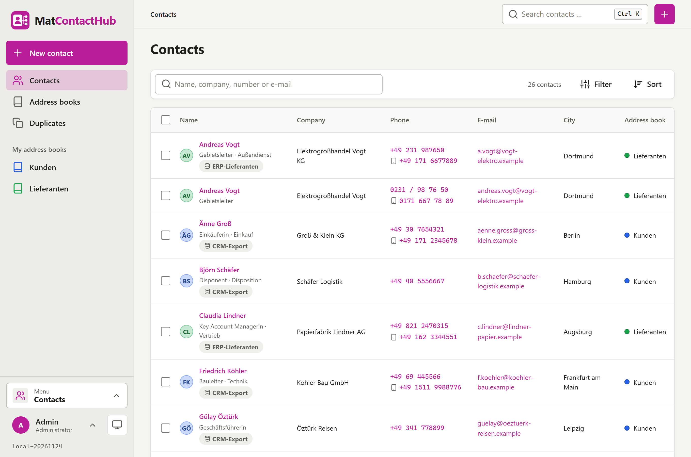</p>

## Features

- **Data sources**: contacts from **REST APIs** (Basic, Bearer or API-key header, pagination by page or next link, nested JSON), **Microsoft SQL Server**
  (a read-only SELECT) and **CSV files** (upload or URL; delimiter and encoding detected). A **field mapping** per source with templates (`{Vorname} {Nachname}`),
  transforms (trim, phone number, case) and **Auto-map** by name; a preview of the first records; a **sync** on a schedule or with "Sync now", with a history
  of runs (read, new, changed, unchanged, deleted, skipped). Contacts that vanish from a source can be deleted softly; they come back as the same contact.
- **Contacts** are the start page: search over names, company, e-mail and **numbers in any notation** (`040/5556667`, `+49 40 5556667` and `0049405556667`
  find each other), filters (address book, origin, hidden), sort, selection actions (hide, export, delete). Manual contacts next to synced ones: a synced
  contact is read-only (the source wins) – only **Hidden** can be set, which takes it out of LDAP and the API.
- **Address books** with the roles Viewer and Editor per person (or shared with everybody), a colour, and the switches **LDAP** and **Apps**.
- **Duplicates**: groups by the same number, e-mail address or name and company; **merge** (the manual contact keeps, gets the empty fields of the others;
  synced ones are hidden) or "not a duplicate".
- **vCard** 3.0/4.0 export (one contact or the filtered list) and **import** of vCard and CSV files.
- A built-in **LDAP server** (LDAPv3: bind, search with every filter, paging, StartTLS, LDAPS with a self-signed or an uploaded certificate) for
  **STARFACE**, IP phones (Yealink, Snom, Grandstream …) and mail clients. A number matches in any notation (`+4930123`, `030123`, `004930123`);
  LDAP accounts with access to chosen address books; a log of the last 500 queries; a Help tab with the values for STARFACE and Yealink.
- A **directory API** for other apps (capability `contacts.directory`): caller-ID lookup and search with a key per app.
- English and German, light and dark, a PWA (installable; the contacts seen last stay readable offline).

## Screenshots

| | |
|---|---|
| 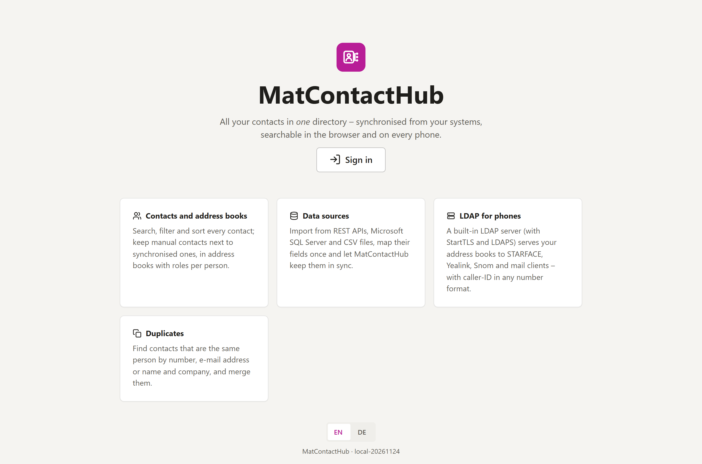 The start page before signing in | 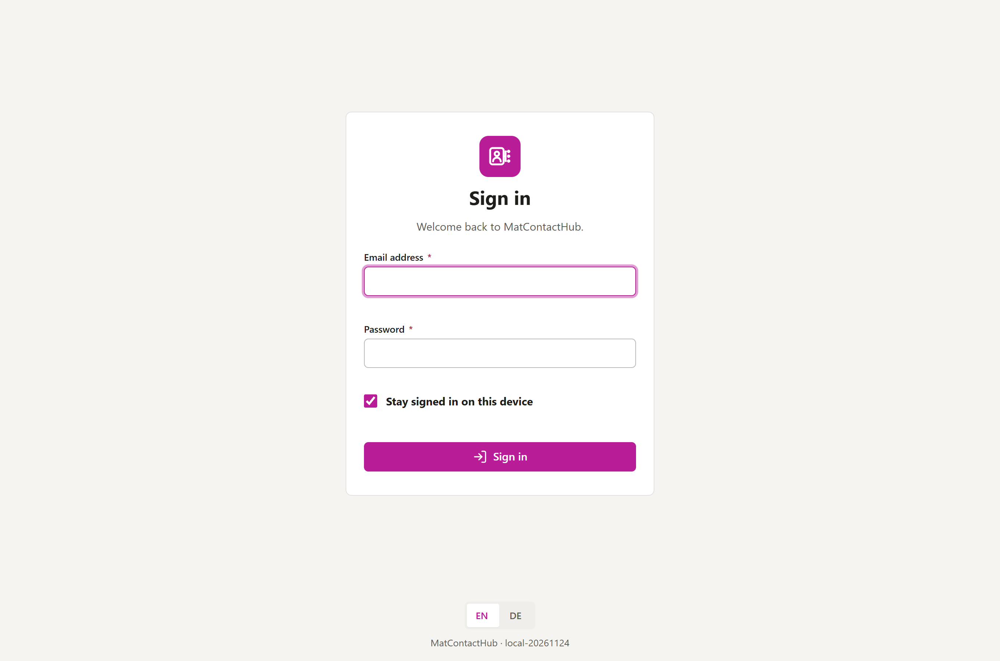 Sign in with a local account (a button for MatIdentity when it is set up) |
| 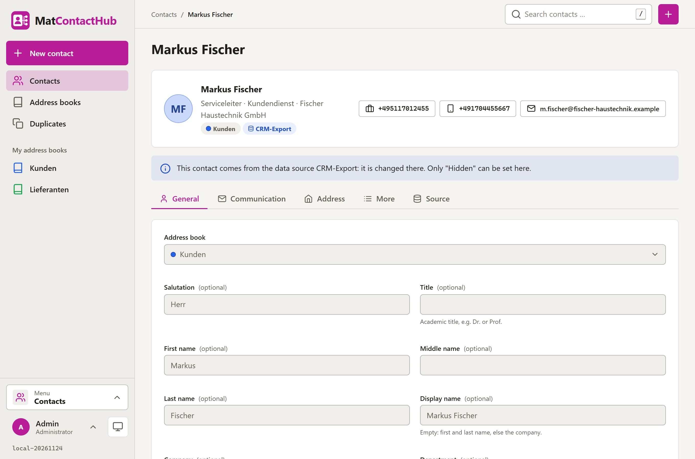 A synced contact: read-only, only *Hidden* can be set | 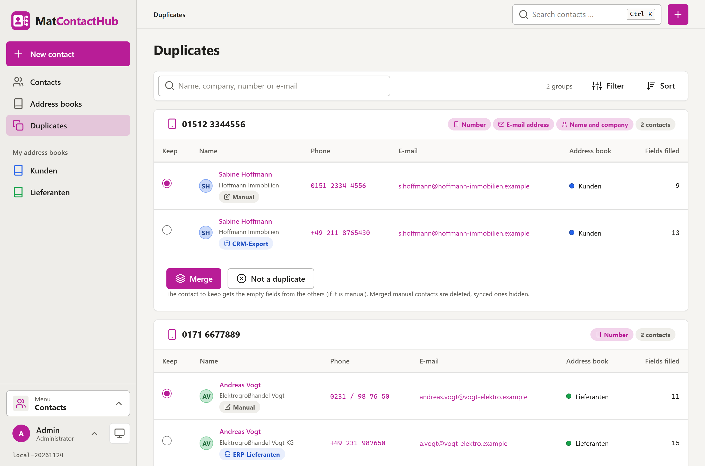 Duplicates by number, e-mail address or name and company, with *Merge* |
| 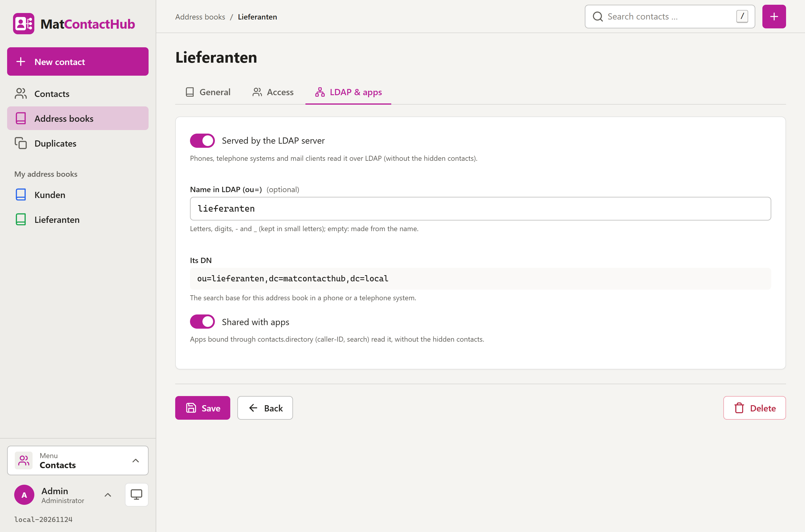 An address book on the tab *LDAP & apps*: its DN for phones and STARFACE | 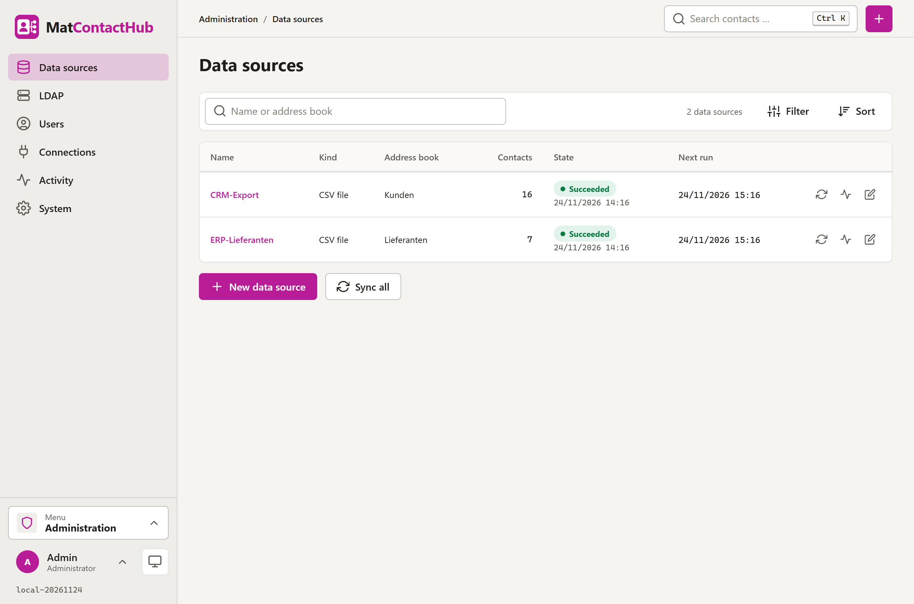 The data sources with the state of the last sync |
| 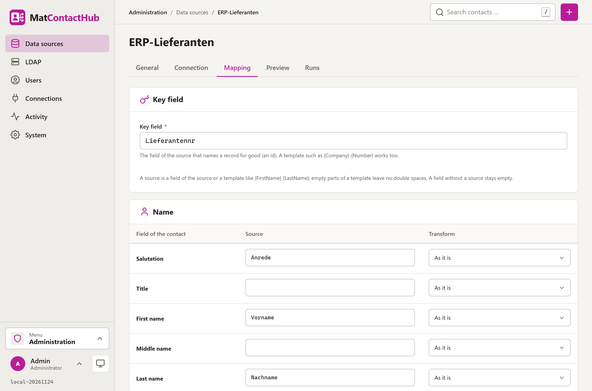 The field mapping of a CSV source (after *Auto-map*) | 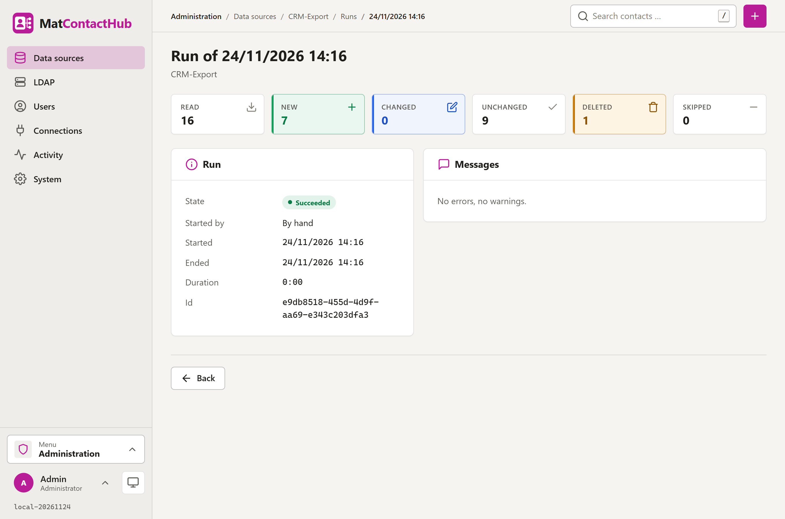 A sync run: read, new, changed, unchanged, deleted, skipped |
| 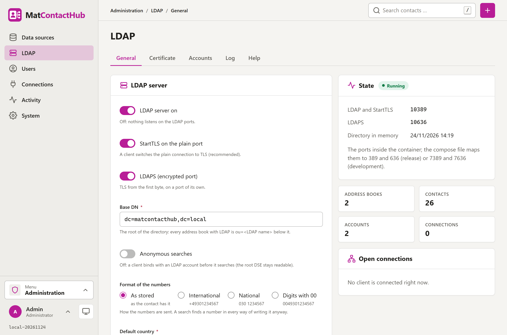 The built-in LDAP server: StartTLS, LDAPS, base DN, number format | 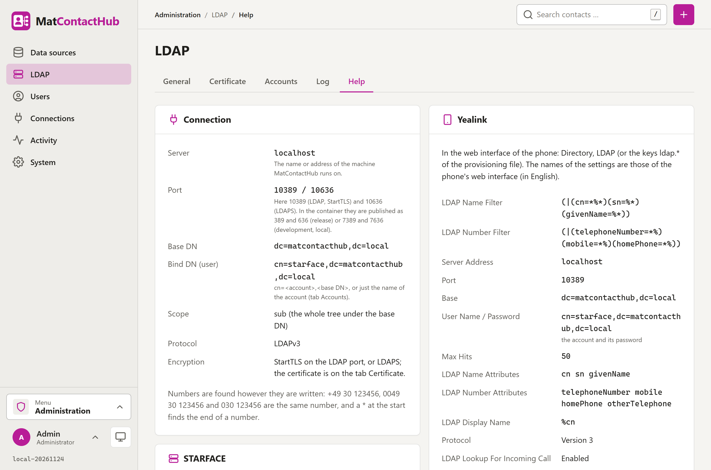 The tab *Help* with the values for STARFACE and Yealink |
| 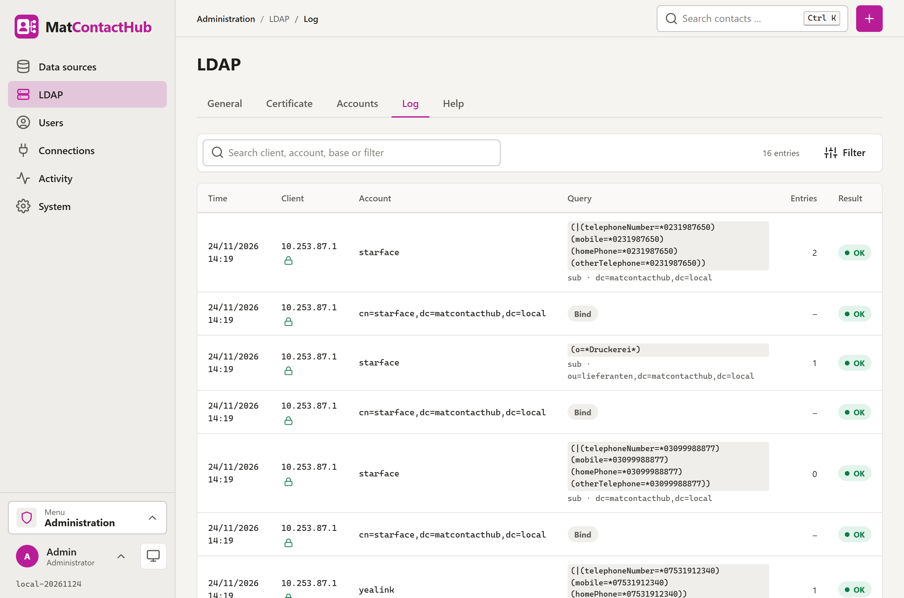 The query log: binds and searches of STARFACE and the phones | 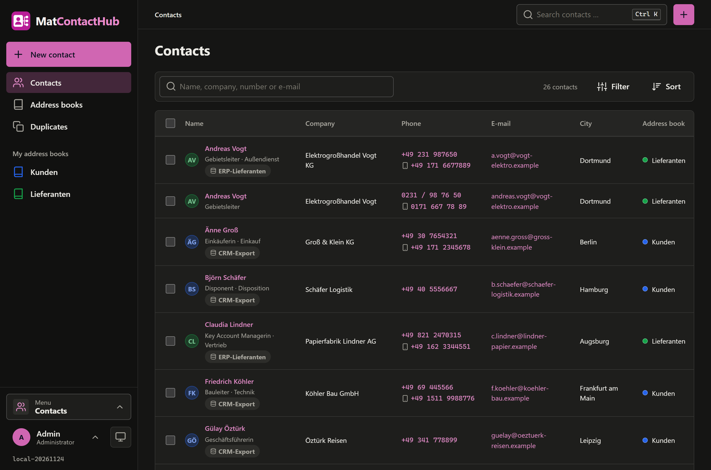 Dark mode |

<p align="center">
  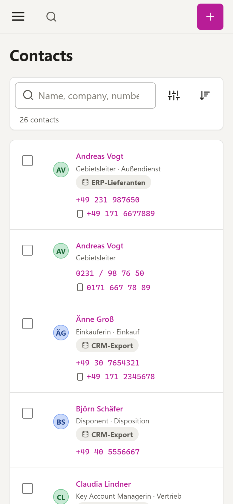
  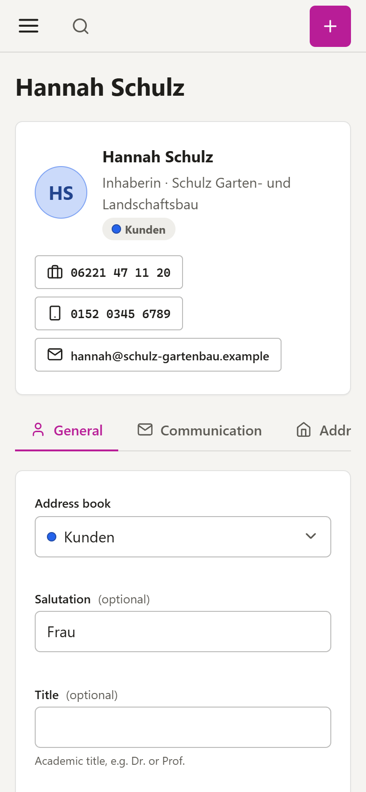
  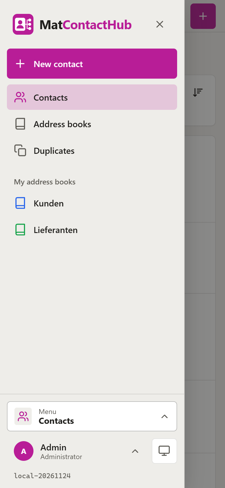
</p>

## Quick start

```bash
curl -O https://raw.githubusercontent.com/Real-TTX/MatContactHub/main/docker-compose.yml
docker compose up -d          # MatContactHub and PostgreSQL
```

| Port (host) | Container | What |
|---|---|---|
| 7087 | 7087 | the web interface (on another host: put it behind a TLS proxy) |
| 389 | 10389 | LDAP, plain and StartTLS |
| 636 | 10636 | LDAPS |

When another LDAP server holds 389/636 on the host, map e.g. `"7389:10389"` and `"7636:10636"` in `docker-compose.yml`.

1. Open <http://localhost:7087>: the **first account that registers is the administrator**.
2. **Address books → New address book**: a name, on the tab *LDAP & apps* switch on **LDAP** (and **Apps** for the directory API).
3. **Administration → Data sources → New**: the kind (REST, SQL Server, CSV), the target address book; the tab *Connection*; *Preview*; *Mapping* →
   **Auto-map**, check the key field; **Sync now**. Or add contacts by hand, or import a vCard/CSV file on the contacts page.
4. **Administration → LDAP → Accounts → New**: an account (e.g. `starface`) with a password and access to the address book.

## STARFACE

In the STARFACE administration add an **LDAP address book** (the tab *Help* under Administration → LDAP shows these values for your installation):

| Setting | Value |
|---|---|
| Server | the name or address of the MatContactHub host |
| Port | 389 (LDAP, StartTLS) or 636 (LDAPS) |
| Encryption | StartTLS or SSL/LDAPS; the certificate is on the tab *Certificate* (self-signed, or upload a PFX) |
| Bind DN (user) | `cn=starface,dc=matcontacthub,dc=local` (or just `starface`) |
| Password | the password of the LDAP account |
| Search base | `dc=matcontacthub,dc=local` (Administration → LDAP → General), scope *sub* |
| Filter by number (caller ID) | `(\|(telephoneNumber=*%)(mobile=*%)(homePhone=*%)(otherTelephone=*%))` |
| Filter by name | `(\|(cn=*%*)(sn=%*)(givenName=%*)(o=%*))` |
| Attributes | `cn` / `displayName` (name), `givenName`, `sn`, `o` (company), `telephoneNumber`, `mobile`, `homePhone`, `facsimileTelephoneNumber`, `mail` |

`%` is what STARFACE puts in (the number of the caller, the name typed). A number is found however it is written – `+49 89 1234567`, `0049891234567` and
`089 1234567` are the same number. Hidden contacts and address books without LDAP are never served. A test from a command line:

```bash
ldapsearch -x -H ldap://<host>:389 -ZZ -D "cn=starface,dc=matcontacthub,dc=local" -W -b "dc=matcontacthub,dc=local" \
  "(|(telephoneNumber=*1234567)(mobile=*1234567))" cn telephoneNumber mobile
# with the self-signed certificate: LDAPTLS_REQCERT=never ldapsearch …
```

## Settings and the Mattiverse

No variable is required: MatContactHub does its whole job without them. **Mattiverse** sets these when it installs MatContactHub and connects it to the
other apps; without it they go under `environment:` of `web`.

| Variable | Meaning |
|---|---|
| `MAT_PUBLIC_URL` | the public address (links in mails, the directory API, the name in the self-signed LDAP certificate); while set, it is fixed on Administration → System |
| `MAT_API_KEY` | the key of the platform API (`/api`) for a broker such as Mattiverse |
| `MAT_FRAME_ANCESTORS` | the origins that may show MatContactHub in a frame (Mattiverse) |
| `MAT_TRUSTED_PROXIES` | the reverse proxies (addresses or networks, `10.0.0.0/8, 172.18.0.5`) whose `X-Forwarded-For` names the visitor; without it only a proxy on the same host counts. The address of a visitor keys the rate limits of the sign-in and the directory API |
| `MATIDENTITY_AUTHORITY`, `_INTERNAL_URL`, `_CLIENT_ID`, `_CLIENT_SECRET` | sign-in through **MatIdentity** (single sign-on of the Mat family; optional) |
| `MATSMTP_HOST`, `_PORT`, `_USERNAME`, `_PASSWORD`, `_FROM`, `_TLS` | mail through **MatSMTP** (optional) |

**Provides `contacts.directory`** (a key capability). Mattiverse binds a consumer by itself; by hand, **Administration → Connections → Offers** issues a key
for an app (shown once). The consumer gets `MAT_CONTACTS_DIRECTORY_URL`, `_INTERNAL_URL`, `_KEY` and calls, with `Authorization: Bearer <key>`:

- `GET /api/directory/lookup?number=…` – the best contact for a number (caller ID; 404 when none)
- `GET /api/directory/search?q=…&limit=…` – the contacts that match

(also under `/api/provides/contacts.directory/`). It reads the address books with **Apps** on, never hidden contacts. MatContactHub also contributes the
launcher *Contacts* (New contact, Address books, Duplicates, Sync now), two admin widgets (the directory, the last sync runs) and its health (failing data
sources = degraded) to the Mattiverse.

## Development

- `./scripts/redeploy.ps1` (or `.sh`) rebuilds the image and starts `docker-compose.local.yml`: the app on <http://localhost:7087>, LDAP on `localhost:7389`,
  LDAPS on `localhost:7636`, pgAdmin on <http://localhost:7088>, PostgreSQL on `localhost:7089`. `-Clean` starts with empty volumes.
- `dotnet build MatContactHub.slnx`; `dotnet test` – the database tests run with `MATCONTACTHUB_TEST_DB` (an administrator connection string, e.g.
  `Host=localhost;Port=7089;Username=matcontacthub;Password=matcontacthub;Database=postgres` while the local stack runs), the SQL Server tests with
  `MATCONTACTHUB_TEST_MSSQL` (see CLAUDE.md).
- Compose files: `docker-compose.yml` (release, `:latest`, 389/636), `docker-compose.dev.yml` (nightly, with pgAdmin, 7389/7636), `docker-compose.local.yml`
  (built here, with pgAdmin, 7389/7636).
- Stack: ASP.NET Core (.NET 10, Razor Pages), EF Core + PostgreSQL, MatUi of [MatDesign](https://github.com/Real-TTX/MatDesign), MatPlatform 2.4,
  libphonenumber-csharp; the LDAP server is its own (System.Formats.Asn1). More in [CLAUDE.md](CLAUDE.md).

### Versions and branches

| Branch | Channel | Version | Image tags |
|---|---|---|---|
| `main` | release | `<major>.<minor>.<build>-<date>`, e.g. `0.1.42-20261124` | `<version>`, `latest`, `release` |
| `dev` | nightly | `nightly-<build>-<date>` | `<version>`, `nightly` |
| anything else, the local stack | local | `local-<date>` | – (built here) |

Major and minor are set once in `Directory.Build.props`; the build number is the run of the GitHub action and the date is the day of the build (UTC). The
action (`.github/workflows/build.yml`) builds and tests every push and pull request to `main` and `dev` and pushes `ghcr.io/real-ttx/matcontacthub` for
`linux/amd64` and `linux/arm64`; pull requests are only built. The version is shown at the bottom of the menu and on the About page. `main` is the
release branch, `dev` the development branch.

### Logo

The logo lives in [`docs/logo`](docs/logo) in its levels of detail: `matcontacthub-logo.svg` and `matcontacthub-logo-dark.svg` (the word mark for light and
dark surfaces), `matcontacthub-mark.svg` (the square mark) and `matcontacthub-mark-512.png`, `matcontacthub-maskable.svg` (Android adaptive icons),
`matcontacthub-mono.svg` (one colour, `currentColor`), `matcontacthub-favicon.svg`, and `preview.html` / `preview.png`, a sheet of all of them. `node scripts/logo.js`
writes the SVGs (also into `src/MatContactHub/wwwroot/img/logo`), `./scripts/icons.ps1` draws the PNGs with Edge (PWA icons, apple-touch-icon, favicons, the sheet).

The screenshots in [`docs/images`](docs/images) are taken from the running app with Playwright and Edge (1360 × 900 and 390 × 844 at 2×), with demo data only.

Made by Matthias Schmoldt.
